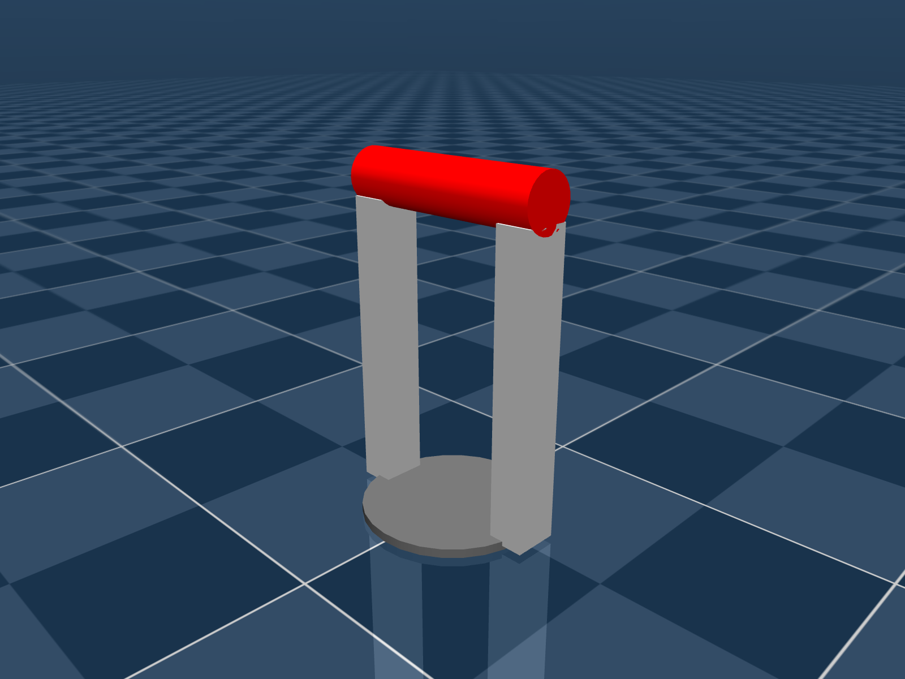
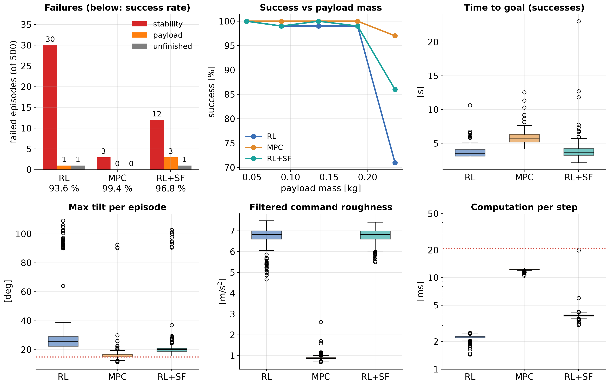
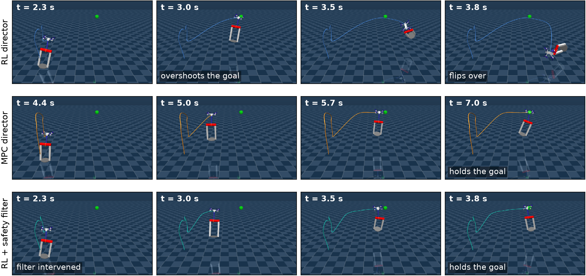

# Adaptive hook drone

Grasping and transporting a payload of unknown mass and size with a quadcopter
that carries a spiral-robot-inspired, tendon-driven manipulator (the
"adaptive hook"), in MuJoCo. Three controllers solve the task on top of the
same learned low-level velocity controller:

* **RL director:** a hierarchical PPO agent trained with curriculum learning,
* **MPC director:** model predictive control on a ResNet model of the closed
  loop, identified from simulation data,
* **RL director + predictive safety filter:** the RL agent, whose commands are
  checked with the identified model and corrected only when they would lead
  to an unsafe state.

This is the code of the TDK thesis on the topic; the documentation of the code
(architecture, environments, training, MPC, safety filter, evaluation, and how
the optimal control problems are solved) is in [`docs/`](docs/README.md).




**Video:** a rescued scenario flown by the three controllers:
[youtu.be/5k_MBPPLFM0](https://youtu.be/5k_MBPPLFM0)

## Results

On the same 500 random scenarios (payload 0.02–0.26 kg, success = goal reached
with the payload and held for 5 s):

| Controller | Success | Median time to goal | Median computation per step |
|---|---|---|---|
| RL director | 93.6 % | 3.5 s | 2.2 ms |
| MPC director | 99.4 % | 5.7 s | 12.3 ms |
| RL director + safety filter | 96.8 % | 3.7 s | 3.9 ms |

The safety filter rescues 23 of the 32 failures of the RL director while it
intervenes in only 4.3 % of the control steps.




## Installation

```bash
git clone --depth 1 https://github.com/Eper00/Adaptive-hook-drone.git   # --depth 1: without the large history
cd Adaptive-hook-drone
python3 -m venv venv && source venv/bin/activate
pip install -r requirements.txt     # the versions the thesis results were produced with
pip install -e .
```

Python 3.10 or newer (tested with 3.12). Run the scripts from the repository
root, since the result paths are relative to it. The trained policies and the
ResNet model are included, so no training is needed to reproduce the results;
the large intermediate files (`results/analysis/methods/episodes.pkl`,
`results/analysis/velocity/runs.pkl`) are not, the scripts regenerate them.

## Quick start

```bash
# watch the controllers
python -m utilities.play --env_type adaptive_director_safety \
    --model_path results/final/rl_adaptive_director_curriculum/final_model.zip
python -m utilities.play --env_type adaptive_director_MPC

# one scenario with all three controllers, with videos
python -m utilities.analyse --test scenario --seed 1290 --max_time 25 --video --video_width 960

# the comparison of the thesis (500 scenarios, about 45 minutes on 6 cores)
python -m utilities.compare_methods --episodes 500 --seed 1000
python -m utilities.plot_comparison_thesis     # Figure 6.1
```

Training, the identification, and the scripts of the thesis figures are
described in [`docs/README.md`](docs/README.md). All figures of the thesis are
in `results/thesis_figures/`.

## Repository layout

```
multi_drone_mujoco/envs/   simulation, task environments, MPC, safety filter
multi_drone_mujoco/wrappers/curriculum.py   curriculum learning
utilities/                 training, evaluation, figures
results/                   trained models, data, analysis outputs, thesis figures
docs/                      documentation of the code
```

## Origin

The simulator is a fork of MuJoCo-Drones-Gym:

```bibtex
@misc{tayal2026mujocodronesgym,
  title={MuJoCo-Drones-Gym: A GPU-Accelerated Multi-Drone Simulator for Control and Reinforcement Learning},
  author={Manan Tayal},
  year={2026},
  eprint={2606.08039},
  archivePrefix={arXiv},
  primaryClass={cs.RO},
  url={https://arxiv.org/abs/2606.08039},
}
```

The Bumblebee meshes and parameters come from
[AIMotionLab-Virtual](https://github.com/AIMotionLab-SZTAKI/AIMotionLab-Virtual).

## License

MIT
