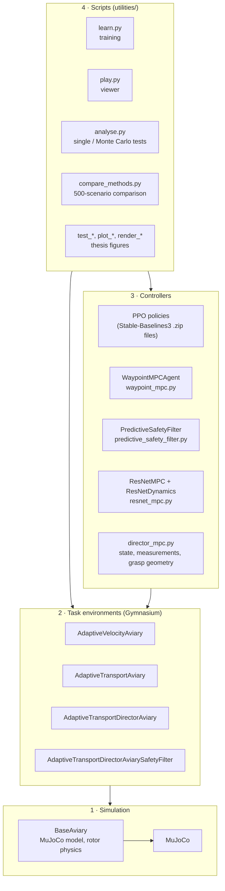
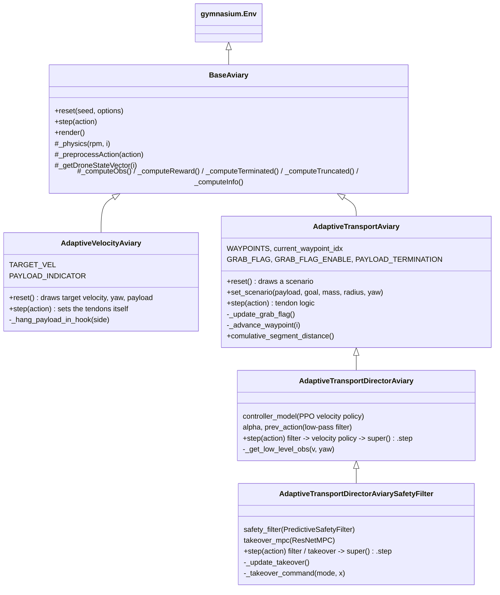
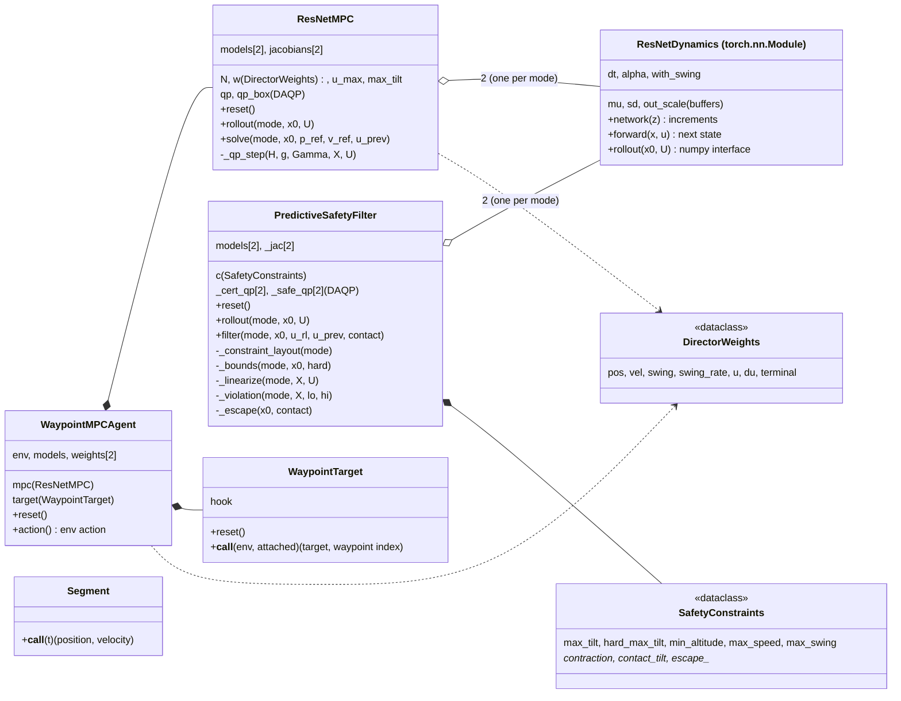
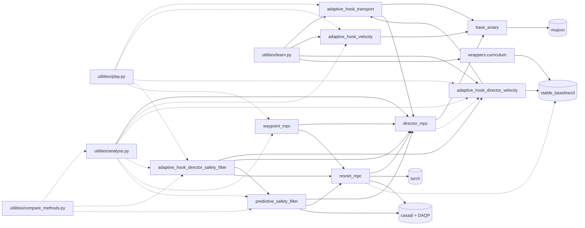
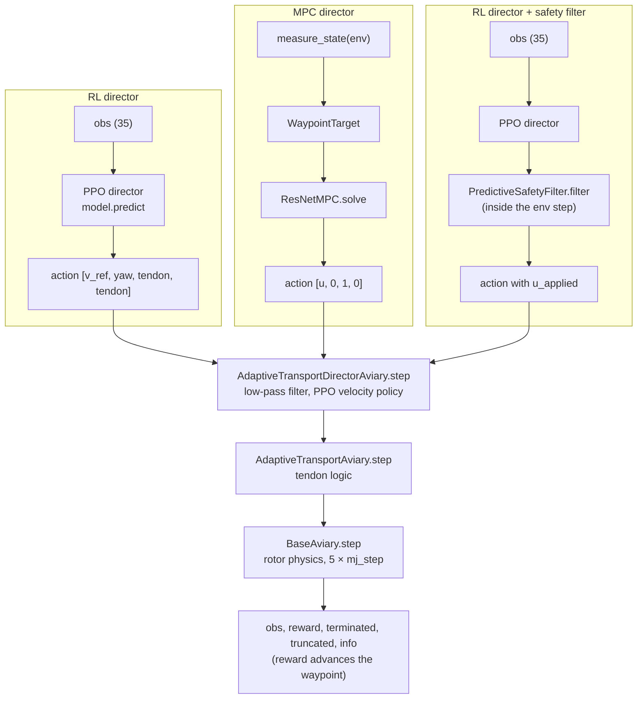

# Architecture

## 1. Layers

The code has four layers. Every layer only uses the ones below it.

The controllers in layer 3 are not Gymnasium agents of the same kind:

* the PPO policies are just `model.predict(obs)` calls on the observation of
  an environment;
* the MPC agent reads the MuJoCo state of the environment directly
  (`measure_state`) and returns an action;
* the safety filter is built *into* an environment
  (`AdaptiveTransportDirectorAviarySafetyFilter.step` calls it), so the RL
  director does not know that it is filtered.

## 2. Class hierarchy of the environments

Every subclass only overrides what changes; a `step` call walks up the chain:
safety-filter env → director env → transport env → `BaseAviary.step`. See
[simulation.md](simulation.md) for the details of each.

## 3. Classes of the controllers

`ResNetMPC` and `PredictiveSafetyFilter` share the same two `ResNetDynamics`
objects (loaded once with `load_or_train`) and the same helper functions of
`resnet_mpc.py`: `rollout`, `step_jacobians`, `sensitivity`.

## 4. Module dependencies

Arrows point from the importing module to the imported one. Dashed arrows are
imports inside functions (to avoid import cycles or slow imports).

Notes:

* `adaptive_hook_transport` imports `grasp_pose` and `APPROACH_HEIGHT` from
  `director_mpc`, so the waypoints of the environment and the grasp target of
  the MPC come from the same function.
* `director_mpc.make_identification_env` imports the director env inside the
  function: `director_mpc` is imported by the transport env, a module-level
  import would be circular.

## 5. The three controllers in one control step

All three run on the same task and the same low-level velocity policy, at
48 Hz (one environment step = 5 MuJoCo steps at 240 Hz).

Detailed sequence diagrams: RL in
[reinforcement_learning.md](reinforcement_learning.md#4-one-step-of-the-rl-director),
MPC in [mpc.md](mpc.md#5-one-control-step-of-the-mpc-director), safety filter
in [safety_filter.md](safety_filter.md#4-one-environment-step).

## 6. Artifacts: what is produced where and used by whom

```mermaid
flowchart LR
    learnV["learn.py<br/>adaptive_velocity"] --> velzip[("results/final/<br/>rl_adaptive_velocity_curriculum/<br/>final_model.zip")]
    velzip --> dirEnv["AdaptiveTransportDirectorAviary<br/>(controller_path)"]
    dirEnv --> learnD["learn.py<br/>adaptive_director"] --> dirzip[("results/final/<br/>rl_adaptive_director_curriculum/<br/>final_model.zip")]
    learnT["learn.py<br/>adaptive_transport"] --> trzip[("results/final/<br/>rl_adaptive_transport[_curriculum]")]
    dirzip --> collect["resnet_mpc.collect_datasets<br/>(RL director flights)"]
    pctl["director_mpc.collect<br/>(P-controller flights)"] --> collect
    collect --> data[("results/resnet/<br/>resnet_training_data.pkl")]
    data --> train["resnet_mpc.train"] --> model[("results/resnet/<br/>resnet_model.pt")]
    model --> wmpc["WaypointMPCAgent"]
    model --> psf["PredictiveSafetyFilter<br/>+ takeover ResNetMPC"]
    dirzip --> cmp["compare_methods.py"]
    wmpc --> cmp
    psf --> cmp
    cmp --> eps[("results/analysis/methods/<br/>episodes.pkl, summary.json")]
    eps --> figs["plot_comparison_thesis.py,<br/>render_rescue_scene.py"] --> tf[("results/thesis_figures/")]
```

The order matters: the velocity policy has to exist before the director can
be trained, and the director policy before the ResNet data can be collected
(its flights are part of the training data). A retrained velocity policy
invalidates the director policy and the ResNet model, since both were
trained on the closed loop with the old one.
