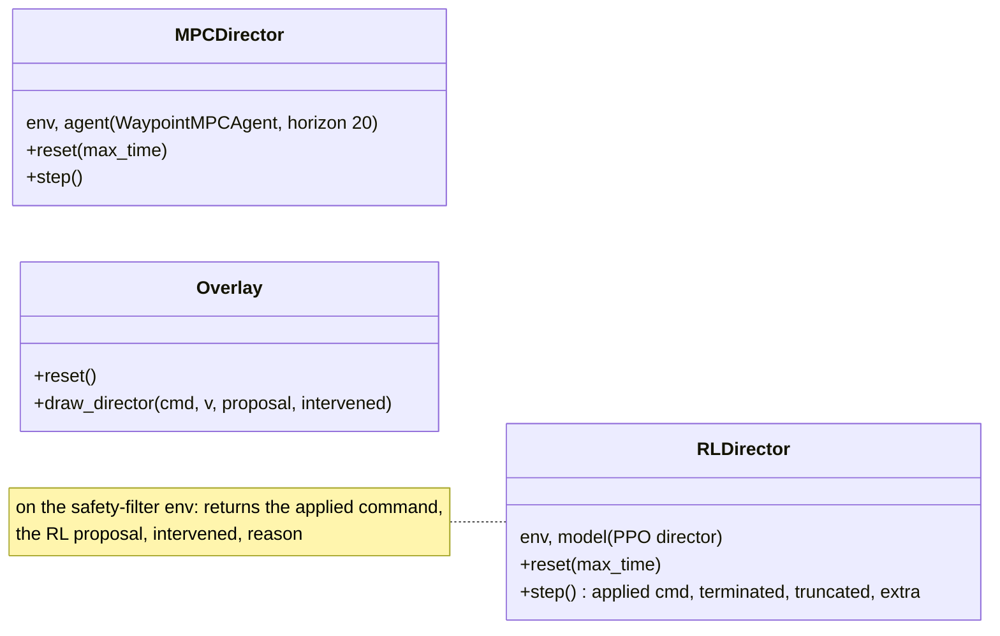
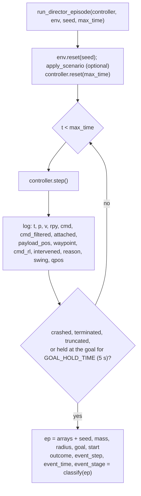
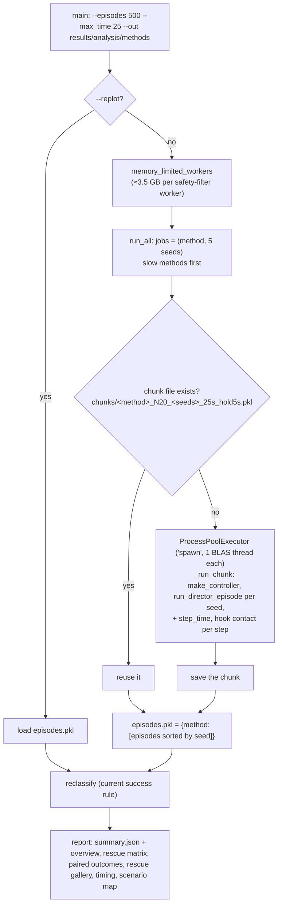

# Evaluation, thesis figures and results

Thesis: Chapter 6 and Appendix A.2. Two scripts fly the controllers
(`utilities/analyse.py`, `utilities/compare_methods.py`); the other scripts of
`utilities/` turn their outputs, or their own test flights, into the
figures of the thesis.

## 1. `utilities/analyse.py`

### 1.1 Building blocks

| Function | What it does |
|---|---|
| `make_director_env(render, safety_filter)` | the director env (or its safety-filter subclass) at the final curriculum level |
| `make_controller(kind, args)` | `kind` ∈ `director`, `director_mpc`, `director_safety` → (env, controller); the RL director uses `results/final/rl_adaptive_director_curriculum/final_model.zip` by default |
| `run_director_episode(controller, env, seed, max_time, ...)` | flies one episode and logs it (see below) |
| `classify(ep)` | the outcome: `success`, `payload`, `stability`, `unfinished` |
| `scenario_from_env`, `apply_scenario`, `build_scenario` | save / replay / override a scenario (payload, goal, mass, radius, yaw) |

### 1.2 One episode

* **Success**: within `GOAL_TOLERANCE` (0.15 m) of the goal with the payload
  attached for `GOAL_HOLD_TIME` (5 s) without a break. The episode stops
  there.
* **Stability**: the drone flipped (roll or pitch beyond 90°) or hit the
  floor. **Payload**: the payload was lifted, then lost. **Unfinished**: none
  of these within `max_time`.
* `cmd_filtered` is `env.prev_action[0:3]`, the filtered command that the
  velocity policy tracks (the "filtered command roughness" of Figure 6.1 is
  computed from it).

### 1.3 Tests (`--test`)

| Test | What it runs | Output (`results/analysis/<test>/`) |
|---|---|---|
| `velocity` | the velocity policy on a reference profile, with and without payload | tracking plots |
| `director`, `director_mpc`, `director_safety` | Monte Carlo over `--episodes` seeds with one controller | per-outcome episodes, summary, failure and intervention plots |
| `compare` | the three controllers on the same seeds (sequential) | comparison plots |
| `scenario` | one scenario (`--seed`, or `--scenario` file, overrides `--mass --radius --payload --goal --yaw`) with all three | `scenario.json`, `results.json`, one `.npz` per method, plots; `--video` renders mp4s offscreen (EGL + ffmpeg) |

## 2. `utilities/compare_methods.py`

The 500-scenario comparison of Chapter 6, run in parallel processes.

* An interrupted run continues where it stopped (finished chunks are kept);
  `--fresh` deletes them. The chunk names contain the horizon and the goal
  hold time, so runs with other settings are not mixed.
* **Pair categories**: the RL and RL + filter runs of a seed are identical
  until the first intervention, so every seed is `kept` (both succeed),
  `rescued` (RL fails, RL + filter succeeds), `not rescued` or `broken` (RL
  succeeds, RL + filter fails).
* `summary.json`: per method the outcome counts, success rate with 95 %
  interval, medians of the time to the goal, tilt, swing and step time, the
  filter activity and the interventions by reason; per seed the pair
  category.

## 3. Thesis figures

Every figure of the thesis that comes from this repository is in
`results/thesis_figures/`, under the file name the thesis uses, and every
script below writes its figures there by default (caches and tables stay in
`results/analysis/`). The folder also holds the hand-made diagrams of the
thesis (`hrl_structure`, `safety_filter_structure` with their generating
`.py` scripts, `mpc_angles.pdf`, `rl_loop.pdf`).

| Figure / table | Script | Input | Output in `results/thesis_figures/` |
|---|---|---|---|
| 1.2, 2.5, 2.6 | `render_pictures.py` | the environments | `drone_hook_*`, `payload_only`, `scene_overview` (png + pdf) |
| 3.2, 3.9 | `plot_seeds.py` (`--preset cl` / `director`, `--overlay`) | `results/seeds/` | `cl_compare.pdf`, `director_vs_transport_seeds.png` (`--name` sets the file name) |
| 3.4, 3.8 | `plot_curriculum_training.py` | `results/final/*/tb`, `evaluations.npz` | `rl_adaptive_*_curriculum_training*` |
| 3.5–3.7 | `test_velocity_policy.py` | velocity policy (runs cached in `results/analysis/velocity/`) | `velocity_*.png` |
| 4.3 | `resnet_training_curve.py` | retrains, `results/resnet/resnet_training_log.json` | `resnet_training.png` |
| 4.4–4.6 | `test_resnet.py` | dedicated test flights (cached in `results/analysis/identification/`) | `resnet_timeseries_*`, `resnet_error_vs_mass` |
| Table 4.2 | `resnet_error_scale.py` | test flights + RL flights | csv in `results/analysis/identification/` |
| 6.1 | `plot_comparison_thesis.py` | `results/analysis/methods/episodes.pkl` | `comparison_overview.png/.pdf` |
| 6.2 | `render_rescue_scene.py` (`MUJOCO_GL=egl`) | `episodes.pkl` (replays the logged qpos) | `rescue_scene.png/.pdf` |
| 6.3 | `plot_scenario_thesis.py` | `results/analysis/scenario/seed_1290/` | `scenario_seed1290.png/.pdf` |

The video of the rescued scenario is made by `make_scenario_movie.py` from the
videos of `analyse.py --test scenario --video` (`results/analysis/scenario/seed_1290_video/`).
`plot_datasets.py` and `replay_datasets.py` show typical flights of the
identification data sets (figure / MuJoCo viewer).

## 4. The `results/` folder

| Folder | Content | Written by |
|---|---|---|
| `final/` | the policies used everywhere: `rl_adaptive_velocity_curriculum`, `rl_adaptive_director_curriculum`, `rl_adaptive_transport[_curriculum]` | `learn.py` |
| `seeds/` | the seed study (3 seeds per method) | `train_seeds.sh` |
| `resnet/` | `resnet_model.pt`, `resnet_training_data.pkl`, `resnet_training_log.json` | `resnet_mpc.train`, `resnet_training_curve.py` |
| `analysis/methods/` | `episodes.pkl` (500 episodes per method), `summary.json`; `rescue_frames/` (the rendered frames of Figure 6.2) | `compare_methods.py`; `render_rescue_scene.py` |
| `analysis/scenario/seed_1290/`, `seed_1290_video/` | the scenario of Figures 6.2–6.3 and its videos | `analyse.py --test scenario`, `make_scenario_movie.py` |
| `analysis/identification/` | the cached model test flights and the error tables | `test_resnet.py`, `resnet_error_scale.py` |
| `analysis/velocity/` | the velocity policy test runs | `test_velocity_policy.py` |
| `thesis_figures/` | all figures of the thesis, as the thesis uses them | the scripts of Section 3 |

## 5. Reproducibility

* A scenario is fully defined by its seed: `AdaptiveTransportAviary.reset`
  draws everything from `env.np_random` after the seeded `BaseAviary.reset`.
  All three controllers therefore fly the same 500 scenarios.
* The RL and RL + filter runs of a seed are identical until the first
  intervention (the RL director converts its action to float64 for this).
* The evaluation runs one BLAS / OpenMP thread per worker. The results are
  then deterministic: a rerun of the comparison reproduces `episodes.pkl`
  seed by seed.
