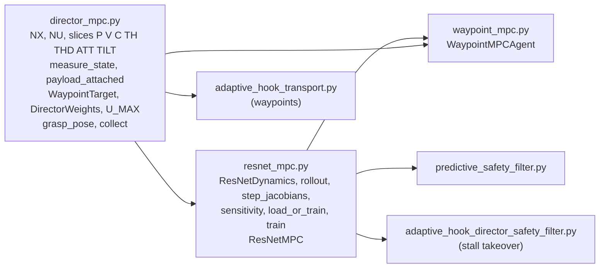
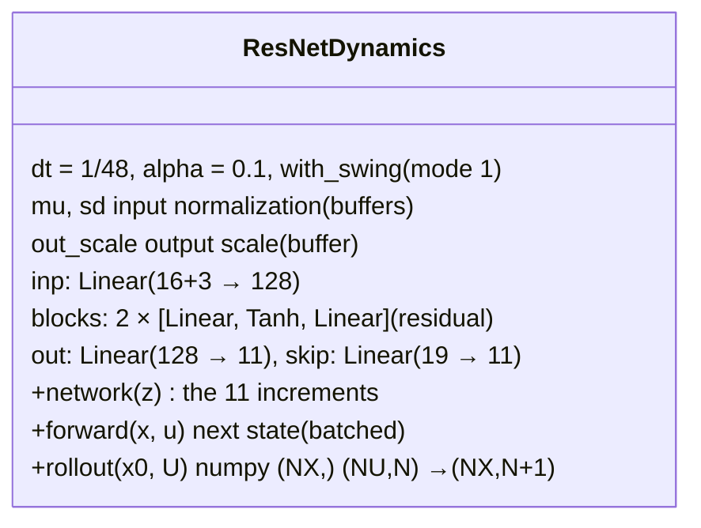
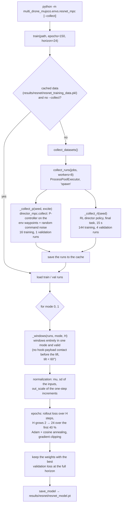
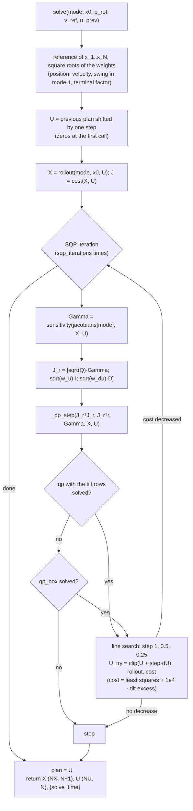
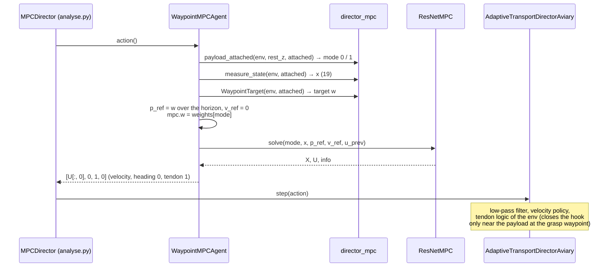

# MPC director

Thesis: Chapter 4. The MPC director replaces the RL director: it computes the
velocity command of the director env with an MPC on an identified ResNet
model of the closed loop "low-pass filter → velocity policy → drone".

Three modules:

| Module | Content |
|---|---|
| `envs/director_mpc.py` | shared building blocks, **no optimizer** despite the name: state layout, measurement of the state, grasp geometry, payload / contact detection, waypoint target, cost weights, P-controller data collection |
| `envs/resnet_mpc.py` | the model (`ResNetDynamics`) and its helpers, data collection and training, the MPC solver `ResNetMPC` |
| `envs/waypoint_mpc.py` | the agent `WaypointMPCAgent`: measure → choose mode, weights and target → solve → act |



## 1. State and measurements (`director_mpc.py`)

The model state (19 values, Section 4.1.1) and its slices:

| Slice | Content | Source (`measure_state(env, attached)`) |
|---|---|---|
| `P` 0:3 | position | `env.pos[0]` |
| `V` 3:6 | velocity | `env.vel[0]` |
| `C` 6:9 | filtered command (output of the low-pass filter) | `filter_state(env)` = `env.prev_action[0:3]` |
| `TH` 9:11 | payload swing angles (world x–z, y–z planes) | `measure_swing(env)`, zero without the payload |
| `THD` 11:13 | swing rates | `measure_swing(env)` |
| `ATT` 13:16 | tilt `roll_w`, `pitch_w` (world frame) and yaw | `attitude(env)` |
| `ATTD` 16:19 | their rates | `attitude(env)` |
| `TILT` 13:15 | the constrained part of `ATT` | |

Helpers used by the MPC, the filter, the environments and the analysis:

| Function / class | What it does | Used by |
|---|---|---|
| `payload_attached(env, rest_z, attached)` | the payload is on the hook: lifted 2 cm above its rest height and touching the hook; stays true until it is 0.7 m away. **Selects the mode** (0 / 1) | MPC agent, filter env, analysis, data collection |
| `hook_payload_contact(env)` | any hook–payload contact | data collection (contact steps are left out of the training data) |
| `grasp_pose(center, radius)` | the drone position for the grasp (+y side of the cylinder, high enough for the hook tip) | transport env waypoints |
| `WaypointTarget` | target position of the MPC: the active waypoint of the env; near the grasp waypoint (`GRASP_SNAP` = 3 cm) a target moved by the measured hook–payload offset, frozen once | MPC agent, P-controller |
| `Segment` | straight line with a trapezoidal velocity profile | stall takeover of the filter env |
| `DirectorWeights` | cost weights: position per axis, velocity, swing, swing rate, command, command change, terminal factor | `ResNetMPC` |
| `U_MAX` = 0.8 | command bound of the MPC | `ResNetMPC`, data collection |
| `director_step(env, command, tendon)` | one director step with direct tendon control (bypasses the transport task's tendon logic) | identification experiments |

## 2. The model (`resnet_mpc.py`)



* One `ResNetDynamics` per mode; `load_model(path)` returns `[mode 0, mode 1]`
  from `results/resnet/resnet_model.pt`, `load_or_train` trains them first if
  the file is missing.
* `forward(x, u)`: the network gets the state without the position and the
  command; the known parts of the update (position integration, the
  low-pass filter, the swing angle from its rate) are written out, the
  network only predicts what depends on the closed loop (Section 4.2.1).
  All computations are in float64.
* Module-level helpers, shared by `ResNetMPC` and `PredictiveSafetyFilter`:

| Function | Returns |
|---|---|
| `rollout(model, x0, U)` | the states x_1 … x_N for the commands U (batched, PyTorch) |
| `step_jacobians(model)` | a function (X, U) → (A, B): the Jacobians of every step in one call (`torch.func.vmap(jacrev(...))`) |
| `sensitivity(jacobians, X, U)` | Γ = d(x_1 … x_N)/dU, built from A, B by a recursion |
| `sqp(U, X, merit, qp_step, rollout, iterations, clip)` | the SQP loop (QP step + backtracking line search on the nonlinear merit) shared by `ResNetMPC` and `PredictiveSafetyFilter` |

## 3. Training data and training



Every run is a dict of arrays: `x` (states), `u` (commands), `attached`,
`valid`, `contact`, plus `source` ("P" / "RL") and `seed`. A sample is the
pair (x_k, u_k) → x_k+1. The seeds of the training and validation runs differ
from the ones of the test scripts (`utilities/test_resnet.py`,
`resnet_error_scale.py`).

## 4. The solver: `ResNetMPC`

Thesis: Section 4.1.3. Construction:

```python
ResNetMPC(models, horizon=40, weights=None, u_max=U_MAX, max_tilt=pi/2,
          sqp_iterations=5, qp_solver="daqp", max_threads=4)
```

It keeps the two models, their step-Jacobian functions, the difference
operator of the command changes and two DAQP QP objects (CasADi `conic`):
`qp` with the linearized tilt rows, `qp_box` with the command bounds only.
`self._plan` holds the previous plan for the warm start; `reset()` clears it.

`solve(mode, x0, p_ref, v_ref, u_prev)` → `(X, U, info)`:



Two users with different settings:

| User | Horizon | Weights | Tilt bound | SQP iterations | Reference |
|---|---|---|---|---|---|
| `WaypointMPCAgent` (MPC director) | 20 | `WAYPOINT_WEIGHTS` / `WAYPOINT_WEIGHTS_PAYLOAD` per mode | 15° | 2 | the active waypoint, constant over the horizon, zero velocity |
| stall takeover of the filter env | 20 | `DirectorWeights()` defaults | 90° (none) | 5 | a `Segment` from the current position to the waypoint |

The line-by-line description of `solve` and `_qp_step` is in
[ocp_solvers.md](ocp_solvers.md#4-mpc-resnetmpcsolve-574631-sor).

## 5. One control step of the MPC director

`WaypointMPCAgent(env, model_file, horizon=20)` loads the models
(`load_or_train`), builds one `ResNetMPC` and keeps a `WaypointTarget`.
`reset()` resets both and reads the rest height of the payload.



The tendon command is always 1 (fully closed): when and in which direction
the hook closes is decided by the environment, exactly as for the RL
director (see [simulation.md](simulation.md#23-stepaction-the-tendon-logic)).
