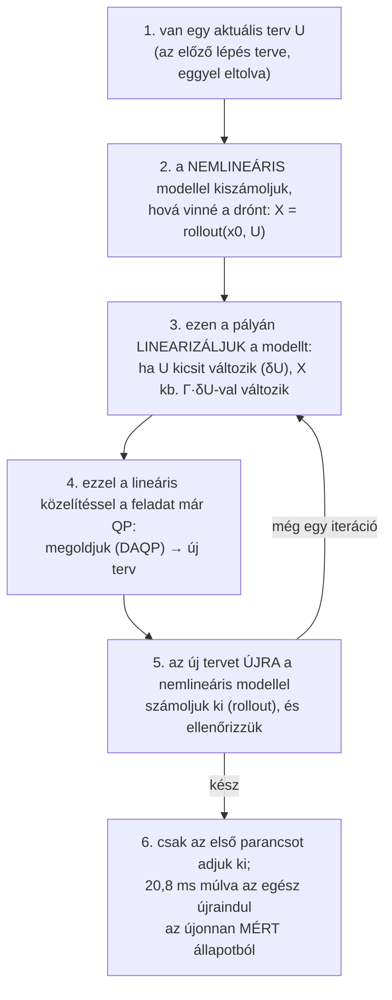
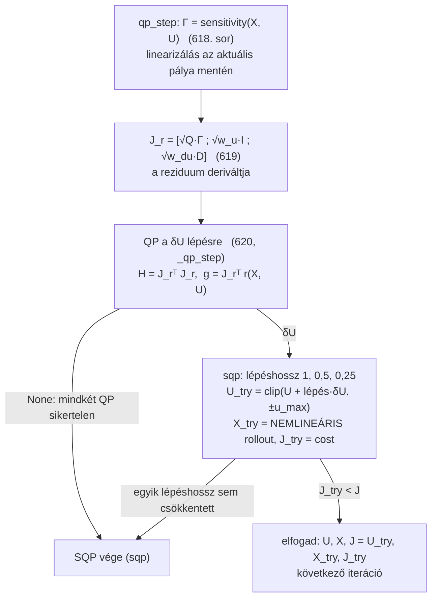
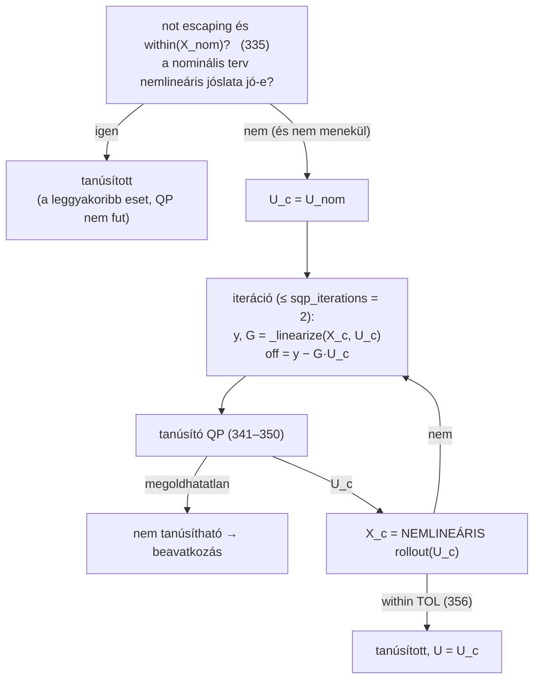
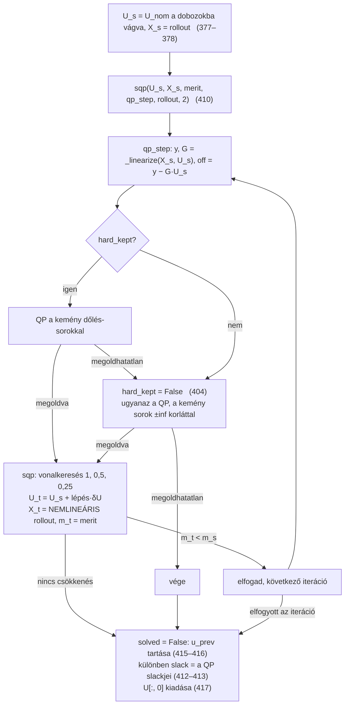

# Hogyan oldja meg a kód az optimális irányítási feladatokat?

Ez az oldal sorról sorra követi a kódot: hogyan oldja meg a `ResNetMPC` a
tézis (4.3) MPC-feladatát, és hogyan oldja meg a `PredictiveSafetyFilter` a
tanúsítást (5.6) és a beavatkozást (5.7). A sorszámok a jelenlegi fájlokra
vonatkoznak:
[resnet_mpc.py](../multi_drone_mujoco/envs/resnet_mpc.py) és
[predictive_safety_filter.py](../multi_drone_mujoco/envs/predictive_safety_filter.py).

Felépítés:

1. [Az ötlet röviden](#1-az-ötlet-röviden): miért nem oldható meg a feladat
   egyetlen QP-vel, mit csinál helyette az SQP, és a közös algoritmus
   (1.4 pont).
2. [Nem baj, hogy a QP csak lineáris közelítéssel számol?](#2-nem-baj-hogy-a-qp-csak-lineáris-közelítéssel-számol)
   Mért számokkal.
3. [Közös építőelemek](#3-közös-építőelemek): rollout, Jacobi-mátrixok, Γ.
4. [MPC: `ResNetMPC.solve`](#4-mpc-resnetmpcsolve-574631-sor) sorról sorra.
5. [Safety filter: `PredictiveSafetyFilter.filter`](#5-safety-filter-predictivesafetyfilterfilter-293426-sor) sorról sorra.
6. [Kód és tézis összevetése](#6-kód-és-tézis-összevetése).

Mindkettő **ugyanazt az SQP-módszert** használja: Gauss–Newton, single shooting, DAQP,
visszalépéses vonalkeresés a nemlineáris jósláton, 2 iteráció.

Jelölések: $N$ a horizont (mindkét helyen 20 lépés = 0,42 s), egy parancs
$u_k \in \mathbb{R}^3$, a terv $U = (u_0, \dots, u_{N-1})$ egy $3N = 60$
hosszú vektorba fűzve (lépésenként egymás után), $X = (x_0, \dots, x_N)$ a
jósolt állapotok, $x_k \in \mathbb{R}^{19}$.

---

## 1. Az ötlet röviden

### 1.1 Mi a feladat?

Mindkét helyen ugyanaz a szerkezet: keresünk egy $U$ parancssorozatot, amely

* **minimalizál** egy költséget (MPC: távolság a waypointtól + parancsok
  nagysága és változása; szűrő: eltérés az RL javaslatától + simaság), és
* **betart** korlátokat a jósolt állapotokra (dőlés, magasság, sebesség,
  lengés) és a parancsokra.

Az állapotokat a ResNet-modell jósolja: $x_{k+1} = x_k + F(x_k, u_k)$.

### 1.2 Miért nem elég egy QP?

Egy QP-megoldó (itt a DAQP) csak olyan feladatot tud megoldani, ahol a
költség **négyzetes**, a korlátok pedig **lineárisak** a változókban. Ha a
modell lineáris lenne ($x_{k+1} = A x_k + B u_k$), akkor minden jósolt
állapot lineáris függvénye lenne $U$-nak, és a feladat pontosan egy QP lenne.

A ResNet viszont nemlineáris (tanh-rétegek): a jósolt dőlés például nem
lineáris függvénye a parancsoknak. Ezt a feladatot egy QP-megoldó közvetlenül
nem tudja kezelni.

### 1.3 Mit csinál helyette: SQP (szekvenciális QP)

Ugyanaz az elv, mint a Newton-módszernél egy egyenlet megoldásakor: nem a
görbét kezeljük, hanem az érintőjét, és lépésenként közelítünk.



A lineáris közelítés tehát **csak arra kell, hogy a QP megmondja, merre
érdemes változtatni a tervet**. Azt, hogy a terv valójában hová viszi a
drónt, mindig a nemlineáris modell számolja ki (5. lépés), és a következő
iteráció már ebből az új pontból linearizál újra.

### 1.4 A közös SQP-algoritmus (MPC és szűrő)

Az MPC és a szűrő beavatkozása **ugyanazt az SQP-kódot** futtatja: a
`resnet_mpc.sqp` függvényt (219–260. sor). Ez a ciklus csak két függvényt kap
a hívótól: a `qp_step(U, X)`-et (linearizálás + QP, ez a feladatfüggő rész)
és a `merit(U, X)`-et (a vonalkeresés költsége). A ciklus maga közös:

```text
U ← melegindítás;  X ← rollout(x0, U);  J ← merit(X, U)
ismételd sqp_iterations = 2-szer:
    Γ ← sensitivity(X, U)                       linearizálás az aktuális pálya mentén
    QP: Gauss–Newton, DAQP  →  új terv U_QP      (ha megoldhatatlan: a kemény dőlés-sorok nélkül)
    lépés ∈ {1; 0,5; 0,25}:
        U_t ← U + lépés·(U_QP − U);  X_t ← rollout(x0, U_t)      NEMLINEÁRIS jóslat
        ha merit(X_t, U_t) < J:  U, X, J ← U_t, X_t, merit;  következő iteráció
    ha egyik lépés sem csökkentette a meritet:  megáll a jelenlegi tervvel
csak U első parancsát adja ki;  U lesz a következő lépés melegindítása
```

```python
def sqp(U, X, merit, qp_step, rollout, iterations, clip=None):   # resnet_mpc.py, 219. sor
    m = merit(U, X)
    for _ in range(iterations):
        r = qp_step(U, X)                     # a hívó QP-je: (dU, extra) vagy None
        if r is None:
            break                             # a QP sikertelen: vége
        dU, extra = r
        for step in (1.0, 0.5, 0.25):         # vonalkeresés
            U_try = U + step * dU             # (az MPC-nél clip a parancskorlátra)
            X_try = rollout(U_try)            # NEMLINEÁRIS jóslat
            m_try = merit(U_try, X_try)
            if m_try < m:
                U, X, m = U_try, X_try, m_try # elfogadva
                break
        else:
            break                             # nincs csökkenés: vége a jelenlegi tervvel
    return U, X, m, solved, extra
```

Az átalakítás előtt és után a kimenet bitre azonos (2026-10-29): 180 MPC-
és 1500 szűrőhívás, valamint egy teljes szcenárió (1290-es seed) mindhárom
módszerrel.

| | MPC (`ResNetMPC.solve`) | Szűrő-beavatkozás (`PredictiveSafetyFilter.filter`) |
|---|---|---|
| költség | távolság a waypointtól + parancsnagyság + parancsváltozás (4.3a) | eltérés az RL javaslatától + parancsváltozás + slack-büntetés (5.7a) |
| korlátok a QP-ben | parancskorlát + linearizált 15°-os dőlés | parancskorlát + lágy korlátok slackkel + linearizált 60°-os dőlés |
| megoldhatatlan QP esetén | a 15°-os dőlés-sorok nélkül | a 60°-os dőlés-sorok nélkül |
| merit a vonalkereséshez | költség + $10^4$ · dőléstúllépés (nemlineáris) | költség, slack helyett a nemlineáris sértésekkel + $10^6$ · 60° fölötti túllépés |
| melegindítás | az előző terv eltolva | a javaslat, utána az előző terv eltolva |
| iterációk | 2 | 2 |

A tanúsítás (5.3 pont) ugyanazokat a linearizált QP-ket használja, de nem
optimalizál, hanem megengedett folytatást keres, és a nemlineáris rollouttal
ellenőriz. Ezért ott nincs vonalkeresés.

---

## 2. Nem baj, hogy a QP csak lineáris közelítéssel számol?

Elvben lehetne baj: a lineáris közelítés csak a linearizálási pont
**közelében** pontos. Ha a QP nagy lépést javasol, a valódi (nemlineáris)
pálya máshol végződhet, mint amit a QP jósolt. A kód és maga a módszer
ezért öt dolgot tesz:

1. **Minden QP után a nemlineáris modell számol.** A QP lineáris jóslata
   soha nem kerül ki eredményként. A következő iteráció, a költség és a
   korlátok ellenőrzése mindig a valódi rolloutból indul.
2. **Melegindítás miatt a lépések kicsik.** A kiinduló terv az előző
   vezérlési lépés terve, eggyel eltolva. 20,8 ms alatt keveset változik a
   helyzet, ezért a szükséges korrekció kicsi, és kis lépésre a lineáris
   közelítés nagyon pontos.
3. **Vonalkeresés (MPC és szűrő-beavatkozás).** A lépést csak akkor fogadja
   el, ha a **nemlineáris** jóslaton is csökken a költség (benne a korlátok
   túllépésének büntetésével). Ha nem csökken, felezi a lépést, majd
   negyedeli. Ha így sem csökken, nem lép tovább.
4. **A szűrő tanúsítása a nemlineáris rolloutot ellenőrzi.** Egy parancs
   csak akkor tanúsított, ha a QP által talált folytatás valódi rolloutja is
   a korlátokon belül marad.
5. **Visszacsatolás (receding horizon).** Csak a terv első parancsa megy ki.
   A következő lépésben a mért állapotból minden újraszámolódik, így egy
   pontatlan lépés hibája nem halmozódik.

### 2.1 Mért számok

Az alábbiakat 8 szcenárió teljes repülése alatt mértem
(`analyse.make_controller`, 25 s, 0–7. seed). Minden QP-lépésnél
összevetettem a lineáris jóslatot ($X + \Gamma\,\delta U$) a ténylegesen
kiszámolt nemlineáris rollouttal.

**MPC director, 8597 QP-lépés:**

| | medián | 95 % | max |
|---|---|---|---|
| a lépés nagysága, $\max |\delta U|$ [m/s] | 0,002 | 0,059 | 1,54 |
| pozícióhiba: lineáris vs. nemlineáris, a horizonton [cm] | 0,000 | 0,009 | 4,2 |
| dőléshiba: lineáris vs. nemlineáris [°] | 0,000 | 0,03 | 14,9 |

A melegindítás miatt a lépések szinte mindig aprók, és a lineáris jóslat
gyakorlatilag pontos. A ritka nagy lépéseknél a hiba nagy lehet (14,9°). Ezeket a
vonalkeresés kezeli: ha a valódi költség nem csökken, a lépés rövidül vagy
elmarad.

**Safety filter, 128 beavatkozás (ugyanaz a 8 szcenárió).** Ezek a mérések
még a **vonalkeresés nélküli, 2 iterációs** szűrővel készültek; ez az
eredmény vezetett ahhoz, hogy a szűrő is vonalkeresést kapjon (lásd lent).

| | medián | 95 % | max |
|---|---|---|---|
| a terv változása, $\max |U_{\text{új}} - U_{\text{lin}}|$ [m/s] | 0,45 | 2,0 | 2,0 |
| dőléshiba: lineáris vs. nemlineáris [°] | 0,6 | 7,1 | 14,5 |
| sebességhiba: lineáris vs. nemlineáris [m/s] | 0,02 | 0,20 | 0,48 |

A beavatkozásnál a lépések **nagyok**: az RL bang-bang parancsától
(például +1) kell egy biztonságosra váltani, ami akár 2 m/s változás egy
komponensben. Itt a lineáris jóslat érezhetően pontatlanabb.

**Mennyire tartja be a beavatkozó terv a korlátokat?** 40 szcenárió, 802
beavatkozás. A „nominális” oszlopban az RL javaslata a teljes horizonton
tartva szerepel:

| | medián | 95 % | max |
|---|---|---|---|
| a beavatkozó terv dőléstúllépése, nemlineáris rollout [°] | 0,23 | 5,7 | 59 |
| ugyanez az RL javaslatával [°] | 7,1 | 18,5 | 63 |
| a beavatkozó terv sebességtúllépése [m/s] | 0,000 | 0,07 | 3,8 |
| ugyanez az RL javaslatával [m/s] | 0,000 | 0,43 | 4,3 |

A beavatkozó terv nemlineáris rolloutja **a beavatkozások 65 %-ában**
teljesen a tolerancián belül van. A többiben is jóval kisebb a túllépés,
mint az RL javaslatánál: a medián dőléstúllépés 7,1° helyett 0,23°. A
maradékot a következő vezérlési lépés javítja, amely a mért állapotból
újraszámol.

**Összefoglalva:** a lineáris közelítés az MPC-ben gyakorlatilag nem okoz
hibát. A vonalkeresés nélküli szűrő beavatkozásánál korlátozott, de mérhető
hibát okozott: a QP tervét a szűrő ellenőrzés nélkül vette át. Ezért a
szűrő beavatkozása most ugyanúgy vonalkereséssel dolgozik, mint az MPC:
a QP terve csak irány, és a lépést a nemlineáris jóslaton mért merit
dönti el (5.4 pont). Mindkettő 2 SQP-iterációt futtat.

---

## 3. Közös építőelemek

Mindkét megoldó **single shooting** módszert használ. A döntési változók
csak a parancsok, az állapotok nem változók, hanem a mért $x_0$-ból indított
rollout eredményei. A dinamikai korlát, a (4.3c) és az (5.7b), ezért
konstrukció szerint mindig pontosan teljesül.

### 3.1 Rollout: `rollout(model, x0, U)` (173–181. sor)

```python
xs, x = [], x0
for k in range(U.shape[-2]):          # k = 0 .. N-1
    x = model(x, U[..., k, :])        # x_k+1 = x_k + F(x_k, u_k)   (ResNetDynamics.forward)
    xs.append(x)
return torch.stack(xs, dim=-2)        # x_1 .. x_N
```

Ez a **nemlineáris** jóslat: a modellt $N$-szer egymás után alkalmazza, a
mért állapotból indulva, közben nincs mérés. Mindkét megoldó ezzel számolja
ki minden új terv valódi következményét.

### 3.2 Lépésenkénti Jacobi-mátrixok: `step_jacobians(model)` (184–195. sor)

Egy függvényt ad vissza, amely egy pálya mind az $N$ lépésére egyszerre
kiszámolja:

* $A_k = \partial x_{k+1}/\partial x_k$ (19 × 19): hogyan hat az állapot
  egy kis változása a következő állapotra;
* $B_k = \partial x_{k+1}/\partial u_k$ (19 × 3): hogyan hat a parancs egy
  kis változása a következő állapotra.

A PyTorch automatikus deriválását használja (`vmap(jacrev(model))`). A
konstruktorban egyszer építi fel, mert az első hívás kb. 0,6 s.

### 3.3 Érzékenység: `sensitivity(jacobians, X, U)` (198–216. sor)

Ez a **linearizált rollout**. Ha a terv egy kicsit változik ($\delta U$),
mennyit változik a jósolt pálya ($\delta X$)?

* A kezdőállapot mért, ezért nem változik: $\delta x_0 = 0$.
* Lépésenként: $\delta x_{k+1} = A_k\,\delta x_k + B_k\,\delta u_k$.
* Kifejtve: $\delta X \approx \Gamma\,\delta U$, ahol
  $\Gamma = \partial(x_1..x_N)/\partial U$ egy $(19N) \times (3N)$ = 380 × 60
  mátrix.

```python
A, B = jacobians(X[:N], U)       # 210: A_k, B_k az aktuális pálya minden lépésében
G = zeros((NX, NU * N))          # 211: d x_0 / dU = 0 (x_0 mért)
for k in range(N):
    G = A[k] @ G                 # 213: ami eddig x_k-ra hatott, A_k-n át x_k+1-re is hat
    G[:, 3k:3k+3] += B[k]        # 214: u_k közvetlenül x_k+1-re hat
    rows.append(G)               # 215: a k-adik blokksor = d x_k+1 / dU
return vstack(rows)              # 216: Γ
```

Γ alsó blokkháromszög alakú: $u_j$ csak a későbbi $x_{j+1}, x_{j+2}, \dots$
állapotokra hat, a korábbiakra nem.

Ez az **egyetlen hely, ahol a modell linearizálva van**, mégpedig a teljes
aktuális pálya mentén ($X$, $U$), nem egyetlen pont körül. Minden
SQP-iteráció újra meghívja az aktuális tervvel.

---

## 4. MPC: `ResNetMPC.solve` (574–631. sor)

A (4.3) feladatot oldja meg Gauss–Newton SQP-vel. Vezérlési lépésenként
egyszer hívódik (`WaypointMPCAgent.action`, illetve a szűrő elakadási
MPC-je).

### 4.1 Előkészítés (581–596. sor)

| Sor | Kód | Jelentés |
|---|---|---|
| 585–586 | `ref[:, P], ref[:, V] = p_ref[:, 1:].T, v_ref[:, 1:].T` | $x_1..x_N$ referenciája: a waypoint $w_k$ minden lépésre, a sebesség 0 |
| 589–592 | `q[P], q[V] = w.pos, w.vel` (+ lengés az 1-es módban) | egy állapot súlyai: pozíció tengelyenként, sebesség, lengés |
| 593–594 | `Q = tile(q, N)`, `Q[-NX:] *= w.terminal` | minden lépésre ugyanaz, az utolsóra $\lambda_K$-szoros (a (4.3a) terminális tagja) |
| 595 | `sq, sq_u, sq_du = sqrt(Q), sqrt(w.u), sqrt(w.du)` | a súlyok gyökei, mert a költséget $\tfrac12\|r\|^2$ alakban írjuk |
| 596 | `e_prev = [u_prev, 0, …]` | $u_{-1|k} = u_{k-1}$, az előző lépésben kiadott parancs |

`D` (556. sor) a különbségképző mátrix: $DU = (u_0, u_1 - u_0, u_2 - u_1, \dots)$.
Így $DU - e_{\text{prev}} = (u_0 - u_{k-1}, u_1 - u_0, \dots)$ pontosan a
(4.3a) parancsváltozásai.

### 4.2 A költség reziduumként (598–610. sor)

A (4.3a) költség minden tagja súlyozott négyzetösszeg, ezért egyetlen
vektorral felírható: $\text{költség} = \tfrac12\|r\|^2$.

```python
r = [ sqrt(Q) * (X[1:] - ref),          # x_1..x_N eltérése a referenciától   (19N elem)
      sqrt(w_u) * U,                    # a parancsok nagysága                  (3N elem)
      sqrt(w_du) * (D U - e_prev) ]     # a parancsok változása                 (3N elem)
```

A `cost(X, U)` (604. sor) **csak a vonalkereséshez** kell. Ez a nemlineáris
jóslat dőléstúllépését is bünteti, mert a QP a dőléskorlátot csak a lineáris
közelítésre tartja be:

$$J(X, U) = \tfrac12 \|r\|^2 + 10^4 \sum_{k=1}^{N} \sum_{\tilde\phi,\, \tilde\theta} \max\big(|\text{dőlés}_k| - \phi_{\max},\ 0\big).$$

### 4.3 Melegindítás (623–625. sor)

```python
U = nullák, ha nincs előző terv; különben [plan[1:], plan[-1]]   # eggyel eltolva, az utolsó parancs ismételve
X = rollout(x0, U);   J = cost(X, U)
```

Az előző lépés tervének második parancsa most az első, és így tovább. Ez az
oka annak, hogy az SQP-lépések általában aprók (lásd a 2.1 pontot).

### 4.4 Egy SQP-iteráció: `qp_step` (612–621. sor) és a közös `sqp` (627. sor)

A `solve` két függvényt ad a közös `sqp`-nek (1.4 pont):

* `qp_step(U, X)` (612–621. sor): linearizál ($\Gamma$), felírja a
  Gauss–Newton QP-t, megoldja (`_qp_step`), és visszaadja a $\delta U$
  lépést;
* `merit = cost` (604. sor), a nemlineáris költség a dőlésbüntetéssel;
* `clip = (-u_max, u_max)`: a próbatervek a parancskorlátra vágva.



**619. sor: a Gauss–Newton-lépés.** A reziduumot linearizáljuk:
$r(U + \delta U) \approx r(U) + J_r\,\delta U$, ahol $J_r = \partial r/\partial U$.

* Az állapotrész deriváltja $\sqrt Q\,\Gamma$, itt jön be a modell
  linearizálása.
* A parancsrészek ($\sqrt{w_u}\,U$, $\sqrt{w_{\Delta u}}(DU - e_{\text{prev}})$)
  eleve lineárisak, deriváltjuk állandó: $\sqrt{w_u} I$, $\sqrt{w_{\Delta u}} D$.

Behelyettesítve $\tfrac12\|r\|^2$-be a QP:

$$\min_{\delta U}\ \tfrac12\, \delta U^\top (J_r^\top J_r)\, \delta U + (J_r^\top r)^\top \delta U .$$

A $H = J_r^\top J_r$ mátrix nem tartalmazza a háló második deriváltjait.
Ezért mindig pozitív szemidefinit, a QP konvex, és megbízhatóan megoldható.

### 4.5 A QP: `_qp_step` (633–652. sor)

A QP változója a **lépés** $\delta U$ (60 elem), ezért a korlátokat az
aktuális tervvel el kell tolni:

| Sor | Korlát | Kód |
|---|---|---|
| 644 | parancskorlát (4.3d): $-u_{\max} \le U + \delta U \le u_{\max}$ | `lbx = -u_max - u`, `ubx = u_max - u` |
| 645 | Γ dőlés-sorai: a jósolt $\tilde\phi, \tilde\theta$ deriváltja | `rows` (2N = 40 sor) |
| 646 | linearizált dőlés (4.3e): $-\phi_{\max} \le \text{dőlés}(X) + \Gamma_{\text{dőlés}}\,\delta U \le \phi_{\max}$ | `lba = -max_tilt - tilt`, `uba = max_tilt - tilt` |

A QP mérete: 60 változó, 40 korlátsor és a 60 változókorlát. A DAQP oldja
meg (`self.qp`, CasADi `conic`).

* **647–648. sor:** ha ez a QP nem oldható meg (a linearizált dőléskorlát
  nem teljesíthető, például mert a drón már a korlát fölött dől), ugyanazt a
  QP-t **a dőlés-sorok nélkül** oldja meg (`self.qp_box`, csak a
  parancskorlátokkal). A dőlést ekkor csak a vonalkeresés $10^4$-es
  büntetése tartja vissza.
* **649–650. sor:** ha ez sem sikerül, `None` lesz az eredmény, és az SQP
  leáll (a közös `sqp`-ben).
* **651–652. sor:** a lépés, ha véges.

### 4.6 Vége (630–631. sor)

`self._plan = U` lesz a következő vezérlési lépés melegindítása. A függvény
$(X, U)$-t ad vissza, a hívó csak $u_0$-t (`U[:, 0]`) adja ki.

A waypoint-MPC 2, a szűrő elakadási MPC-je 5 iterációt futtat.

---

## 5. Safety filter: `PredictiveSafetyFilter.filter` (293–426. sor)

Két különböző feladat. Mindkettőt Gauss–Newton QP-kkel oldja meg a
linearizált modellen, de **az abszolút parancsokban** $U$ írja fel, nem a
lépésben:

$$y(U) \approx y(U_c) + G\,(U - U_c) = \underbrace{y(U_c) - G\,U_c}_{\texttt{off}} + G\,U ,$$

ahol $y$ a korlátozott állapotelemek $x_1..x_N$-ben, $G = \partial y/\partial U$
pedig Γ ezekhez tartozó sorai (`_linearize`, 247–254. sor). Minden QP egy
teljes **jelölt** tervet ad; a beavatkozásnál a vonalkeresés dönti el, hogy
mennyit lép felé (ez ugyanaz, mint az MPC-ben $U + \alpha\,\delta U$, mert
$\delta U = U_{\text{QP}} - U_s$).

### 5.1 Korlátok elrendezése (konstruktor, 201–217. sor)

Lépésenként a korlátozott állapotelemek, mindegyik egy sor:

| Csoport (slack) | Sorok | Lágy korlát | Kemény korlát |
|---|---|---|---|
| 0 dőlés | `roll_w`, `pitch_w` | ±15° | ±60° |
| 1 magasság | $p_z$ | [0,3; 1000] m | – |
| 2 sebesség | $v_x, v_y, v_z$ | ±1 m/s | – |
| 3 lengés (csak 1-es mód) | $\theta_x, \theta_y$ | ±45° | – |

A horizonton $n_c N$ sor: 0-s módban 6 · 20 = 120, 1-es módban 8 · 20 = 160.
Az `E` mátrix minden sort a csoportja slackjéhez rendel. A `hard` a kemény
korlátos sorokat (a 2N = 40 dőlés-sort) sorolja fel.

### 5.2 Egy hívás előkészítése (296–325. sor)

| Sor | Kód | Jelentés |
|---|---|---|
| 298 | `u_rl = clip(u_rl, ±u_max)` | a javaslat, $u_{\mathrm{RL},k}$ |
| 300 | `lo, hi = _bounds(mode, x0)` | az (5.4) korlátai lépésenként. **Lazítás** (231–245. sor): ha $x_0$ már $e$-vel túllépi a korlátot, a $k$-adik lépés korlátja $e \cdot 0{,}9^k$-val kijjebb kerül |
| 301 | `within = ...` | a nemlineáris jóslat ellenőrzése a `TOL` tűréssel (1°, 1 cm, 3 cm/s, 2°) |
| 304 | `u_ref = tile(u_rl, N)` | a teljes terv célja a javaslat |
| 306–307 | `e_prev = [u_prev, 0, …]` | $u_{-1|k}$ a simasági taghoz |
| 310–315 | `escaping = _escape(...)`, `lb0, ub0` | az első parancs doboza: ±u_max, vagy menekülés közben az emelkedési doboz (5.1.4 fejezet) |
| 321–325 | `U_nom = [u_rl, plan[:, 2:], plan[:, -1]]`, `X_nom = rollout` | nominális terv: most a javaslat, utána az előző terv eltolva |

### 5.3 Tanúsítás (5.6), 327–358. sor

A kérdés: **ha most $u_{\mathrm{RL}}$-t adjuk ki, van-e olyan folytatás,
amellyel a drón biztonságban marad?**



**A tanúsító QP** (341–350. sor), változók: $U$ (60):

$$\min_U\ \tfrac12 w_1 \sum_{j=1}^{N-1}\|u_j - u_{\mathrm{RL}}\|^2 + \tfrac12 w_{\Delta u}\|DU - e_{\text{prev}}\|^2$$
$$\text{f.h.}\quad u_0 = u_{\mathrm{RL}}\ (\texttt{lbx = ubx}),\qquad lo \le \texttt{off} + G\,U \le hi\ \text{(kemény, slack nélkül)},\qquad |u_j| \le u_{\max}$$

* `H = _H_cert` (191. sor) = `diag(0, w1, …, w1) + w_du·DᵀD`. $u_0$-ra
  nincs követési tag, mert rögzített.
* `g` (345. sor): ugyanennek a költségnek a lineáris része.
* A sorok az (5.4) lágy korlátai, de itt keményként (120 vagy 160 sor). A
  60°-os sorok nincsenek benne.
* **A megoldhatatlanság itt nem hiba, hanem a válasz:** nincs olyan
  folytatás, amely a linearizált jóslatot a korlátokon belül tartaná, tehát
  `u_rl` nem tanúsítható.
* A megoldott QP csak **jelölt** folytatást ad. Csak akkor fogadja el, ha a
  **nemlineáris** rolloutja is a tolerancián belül van. Itt nincs szükség
  vonalkeresésre: ez nem optimalizálás, hanem egy megengedett folytatás
  keresése, és az ellenőrzést maga a nemlineáris rollout végzi.

### 5.4 Beavatkozás (5.7), 364–417. sor

Akkor fut, ha a javaslat nem tanúsítható, vagy ha a drón menekül. A kérdés:
**mi a javaslathoz legközelebbi biztonságos parancs?**

Változók: $z = [U\ (60),\ s\ (4)]$, csoportonként egy slack $s_g \ge 0$.

**A QP költsége** (`_H_safe` 193–196. sor, `g` 389. sor):

$$\tfrac12 w_0\|u_0 - u_{\mathrm{RL}}\|^2 + \tfrac12 w_1\sum_{j\ge1}\|u_j - u_{\mathrm{RL}}\|^2 + \tfrac12 w_{\Delta u}\|DU - e_{\text{prev}}\|^2 + \sum_g \big(\rho_g s_g^2 + \rho_{1,g}\, s_g\big)$$

$(\rho, \rho_1)$ = dőlés $(10^6, 10^4)$, magasság $(10^5, 10^3)$, sebesség
$(10^4, 10^2)$, lengés $(10^3, 10)$. A sorrend adja a prioritást: ha nem
teljesíthető minden, előbb a lengés sérül, utoljára a dőlés.

**Korlátok** (a 386. sor `A` mátrixa három sorblokkból áll):

| Sorok | Kód | Korlát |
|---|---|---|
| `[G, −E]` | `uba = hi − off` | $\texttt{off} + GU - E s \le hi$ (felső lágy korlátok) |
| `[G, +E]` | `lba = lo − off` | $\texttt{off} + GU + E s \ge lo$ (alsó lágy korlátok) |
| `[G[hard], 0]` | `hard_lo − off ≤ … ≤ hard_hi − off` | kemény dőléskorlát (5.7d), ±60° (ez is lazul, 373. sor) |
| változókorlátok | `lbx`, `ubx` | $u_0 \in [lb_0, ub_0]$ (menekülési doboz vagy ±u_max), $|u_j| \le u_{\max}$, $s \ge 0$ |

A QP mérete az 1-es módban: 64 változó, 2 · 160 + 40 = 360 sor.
Csoportonként **egy** slack van a teljes horizontra, így a büntetés a
csoport **legnagyobb** sértésére vonatkozik.

**A vonalkeresés meritje** (`_merit`, 264–279. sor): ugyanaz a költség, de
a slackek helyén a **nemlineáris** jóslat valódi legnagyobb sértései
csoportonként ($v_g$), plusz egy nagy büntetés a 60°-os korlát fölött:

$$m(U) = \tfrac12 w_0\|u_0 - u_{\mathrm{RL}}\|^2 + \tfrac12 w_1\sum_{j\ge1}\|u_j - u_{\mathrm{RL}}\|^2 + \tfrac12 w_{\Delta u}\|DU - e_{\text{prev}}\|^2 + \sum_g \big(\rho_g v_g^2 + \rho_{1,g}\, v_g\big) + 10^6 \cdot (\text{túllépés a 60° fölött})$$

Ez az MPC `cost`-jának megfelelője: ott a $10^4$-es dőlésbüntetés játssza
ugyanezt a szerepet.

**Iterációk** (377–416. sor): a `filter` két függvényt ad a közös `sqp`-nek:

* `qp_step(U_s, X_s)` (380–405. sor): linearizál, felírja és megoldja a
  beavatkozó QP-t (ha a 60°-os sorokkal megoldhatatlan, nélkülük, és a
  `hard_kept = False` a hívás további részére megmarad). A QP egy teljes
  tervet ad; a lépés $\delta U = U_{\text{QP}} - U_s$, mellé a slackek;
* `merit` (409. sor) = `_merit`, a nemlineáris merit.



* **Vonalkeresés (a közös `sqp`-ben):** a QP terve csak irány. A lépés
  $U_s + \alpha\,\delta U$, $\alpha \in \{1;\ 0{,}5;\ 0{,}25\}$; az első olyat
  fogadja el, amelynél a nemlineáris merit csökken. A két terv konvex
  kombinációja a parancsdobozokon belül marad, ezért itt nem kell vágni
  (`clip=None`). Ha egyik lépéshossz sem csökkenti a meritet, a jelenlegi
  tervvel áll meg, ugyanúgy, mint az MPC.
* **Kemény korlát tartaléka (392–404. sor):** ha a QP a 60°-os sorokkal
  megoldhatatlan, újra megoldja nélkülük. Ez a tézis „solved without
  (5.7d)” mondata; a merit ilyenkor is bünteti a 60° fölötti dőlést.
* **Tartás (414–416. sor):** ha már az első QP sem megoldható, a szűrő az
  előző parancsot adja ki az első parancs dobozába vágva. A slackek miatt
  ez elvileg nem fordulhat elő.

### 5.5 Vége (421–426. sor)

`self._plan = U`: a tanúsított folytatás vagy a beavatkozó terv lesz a
következő lépés nominális folytatása. Az ok `none` (tanúsított), `contact`
(menekülés) vagy `constraint`.

### 5.6 MPC és szűrő: ugyanaz az SQP-kód (`resnet_mpc.sqp`)

| | MPC (`ResNetMPC`) | Szűrő-beavatkozás |
|---|---|---|
| linearizálás | `sensitivity` (Γ) | ugyanaz, a korlátozott sorokra (`_linearize`) |
| QP | Gauss–Newton, DAQP, a lépésben $\delta U$ | Gauss–Newton, DAQP, az abszolút $U$-ban (ugyanaz a lépés: $U_{\text{QP}} - U_s$) |
| megoldhatatlan QP | a 15°-os dőlés-sorok nélkül | a 60°-os dőlés-sorok nélkül (a lágy korlátok slackkel maradnak) |
| vonalkeresés | 1 / 0,5 / 0,25, a nemlineáris `cost`-on ($10^4$ dőlésbüntetés) | 1 / 0,5 / 0,25, a nemlineáris `_merit`-en (slack helyett valódi sértés, $10^6$ a 60° fölött) |
| ha nincs csökkenés | megáll a jelenlegi tervvel | megáll a jelenlegi tervvel |
| iterációk | 2 | 2 (a tanúsításban is legfeljebb 2) |

---

## 6. Kód és tézis összevetése

| Pont | Tézis | Kód |
|---|---|---|
| MPC megoldó | Gauss–Newton SQP, DAQP, melegindítás (4.1.3) | ugyanez, 2 iterációval, plusz **visszalépéses vonalkeresés** (1 / 0,5 / 0,25) a nemlineáris költségen $10^4$-es dőlésbüntetéssel, és **tartalék QP a dőlés-sorok nélkül**, ha a linearizált dőléskorlát megoldhatatlan |
| MPC dőlés (4.3e) | kemény korlát | a QP-ben kemény; csak egy megoldhatatlan iterációban marad el, akkor a vonalkeresés bünteti |
| MPC költség | (4.3a), $\tfrac12$ szorzókkal | azonos |
| Szűrő költsége (5.7a) | $\lambda_0\|\cdot\|^2 + \lambda_1\sum\|\cdot\|^2 + \lambda_{\Delta u}\sum\|\cdot\|^2$ | ugyanezek a tagok $\tfrac12$ szorzóval, plusz az 5.1.3 fejezet slack-büntetései, $\sum_g(\rho_g s_g^2 + \rho_{1,g} s_g)$ |
| Lágy korlátok (5.7c) | „heavily penalized” (5.1.3) | csoportonként egy slack a teljes horizontra, négyzetes + lineáris büntetés (az 5.2 táblázat prioritásai) |
| Kemény dőlés (5.7d) | „if it cannot be satisfied, the problem is solved without (5.7d)” | pontosan ez: újrapróbálja a kemény sorok nélkül, a hívás hátralevő részére |
| Tanúsítás (5.6) | először az eltolt előző terv, majd egy megengedett folytatás keresése rögzített $u_0$-val | ugyanez: nominális rollout ellenőrzése, majd legfeljebb 2 tanúsító QP kemény (lágy) korlátokkal, mindegyik csak a nemlineáris ellenőrzés után elfogadva |
| Szűrő iterációi | Gauss–Newton SQP, 2 iteráció (5.1 táblázat) | 2 iteráció (mint a tézisben), de **vonalkereséssel a nemlineáris meriten**, ugyanúgy, mint az MPC |
| Már sértett korlátok | a jelenlegi értékre lazítva, lépésenként 0,9-szeresre szűkülve (5.1.3) | `_bounds`, a lágy és a kemény korlátokra is |
