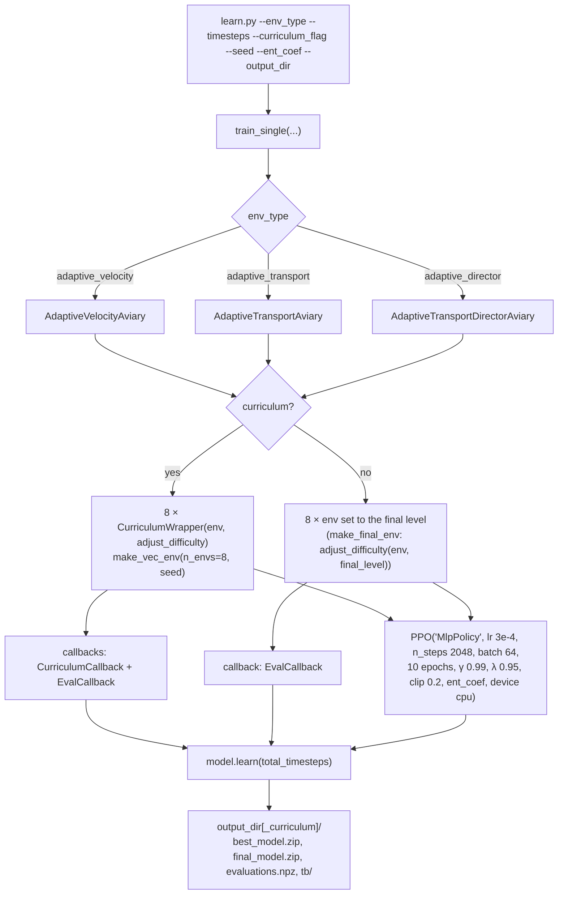
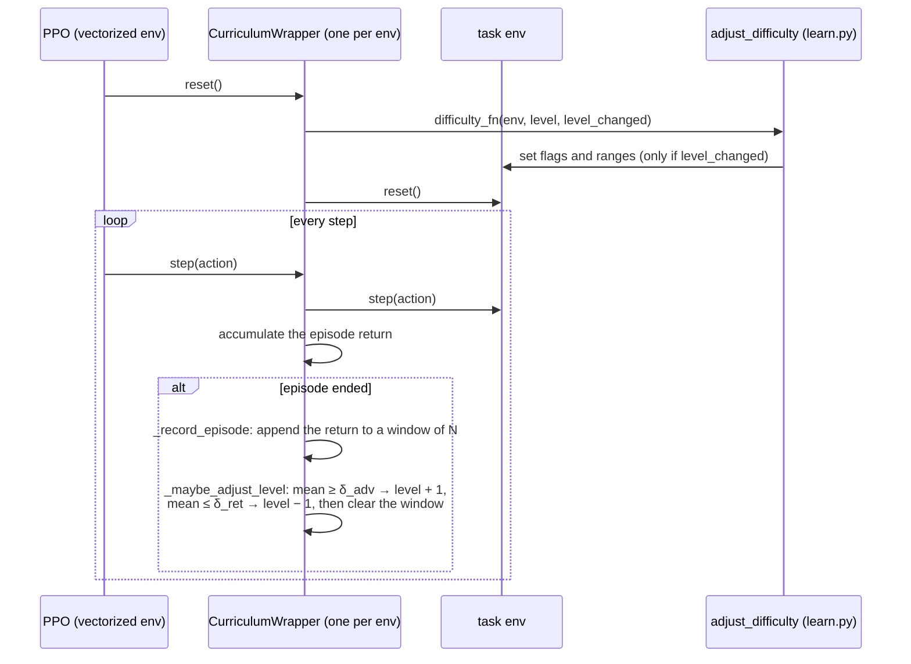
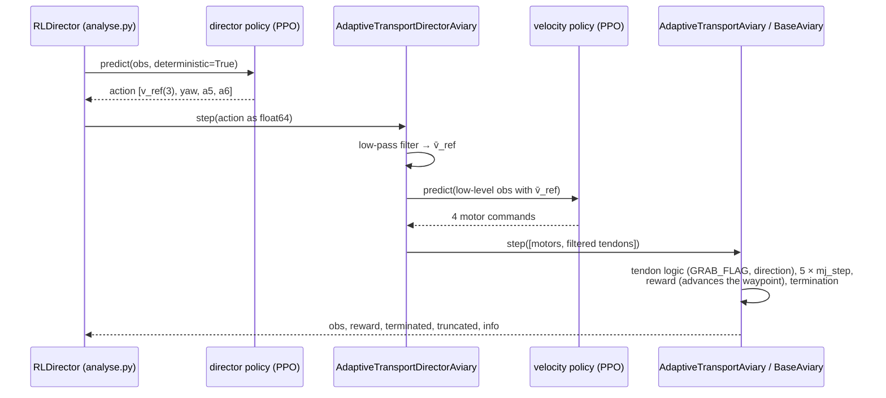

# Reinforcement learning

Thesis: Chapter 3. The three policies are PPO policies of Stable-Baselines3,
trained by one script, `utilities/learn.py`, on the environments of
[simulation.md](simulation.md).

| Policy | Environment | Result folder | Thesis |
|---|---|---|---|
| velocity controller (low level) | `AdaptiveVelocityAviary` | `results/final/rl_adaptive_velocity_curriculum/` | 3.3.2–3.3.5 |
| RL director (high level) | `AdaptiveTransportDirectorAviary` | `results/final/rl_adaptive_director_curriculum/` | 3.3.6–3.3.7 |
| transport policy (flat agent) | `AdaptiveTransportAviary` | `results/final/rl_adaptive_transport[_curriculum]/`, `results/seeds/transport_s*` | 3.1.5, 3.2 |

Every result folder holds `best_model.zip` (best evaluation return),
`final_model.zip` (end of training), `evaluations.npz` and the TensorBoard
log `tb/`. The rest of the code uses the **final** models.

## 1. Training: `utilities/learn.py`



* The evaluation environment is a separate single env (seed + 100). With the
  curriculum it is also wrapped, and `CurriculumCallback` keeps it at the
  highest level reached by the training envs.
* `EvalCallback` evaluates every 5000 steps per env (every 40 000 steps in
  total) on 5 episodes and keeps `best_model.zip`.
* Without the curriculum the envs are created directly at the final level,
  so both variants are trained and evaluated on the same final task.
* The director env loads the velocity policy itself, so the velocity
  controller has to be trained first.
* `utilities/train_seeds.sh` runs the seed study of the thesis (Figures 3.2
  and 3.9): several `learn.py` runs in parallel with `--seed` and
  `--output_dir results/seeds/...`.

## 2. Curriculum

Thesis: Section 3.2. Two pieces: a generic wrapper that decides **when** to
change the level, and a task-specific function that decides **what** a level
means.



* `CurriculumConfig` (`wrappers/curriculum.py`) holds the metric (`reward`),
  the thresholds, the window size and the number of levels. **Only one
  preset is active**: the plain fields are the transport / director preset
  (4 levels, window 100, δ_adv = 1000); the velocity preset (3 levels,
  window 20, δ_adv = 110) is kept in a string next to it and has to be
  swapped in before training the velocity controller.
* Every parallel env has its own level. `CurriculumCallback` logs the level
  to TensorBoard and sets the evaluation env to the highest one.
* `adjust_difficulty(env, level, level_changed)` in `learn.py`:

| Level | Transport / director (Table 3.2) | Velocity (Table 3.3) |
|---|---|---|
| 0 | waypoints only (`GRAB_FLAG_ENABLE = False`) | no payload |
| 1 | payload 0.05 kg, R 0.02–0.025 m, goal ±1 m | payload 0.05 kg, R 0.02–0.03 m, random yaw |
| 2 | payload 0.01–0.25 kg, R 0.02–0.04 m, goal ±1 m | payload 0.01–0.25 kg, R 0.02–0.04 m |
| 3 | as 2, goal ±1.5 m, `PAYLOAD_TERMINATION = True` | – |

## 3. Playing a policy: `utilities/play.py`

```bash
python -m utilities.play --env_type adaptive_director --model_path results/final/rl_adaptive_director_curriculum/final_model.zip
```

`play(model_path, env_type, episodes, curriculum_flag)` creates the env with
`render_mode="human"`, sets it to the final curriculum level, and runs
`model.predict` (or, for `adaptive_director_MPC`, `WaypointMPCAgent.action`)
in a loop with the viewer. For the director types it prints the outcome of
every episode. `env_type` can be `adaptive_velocity`, `adaptive_transport`,
`adaptive_director`, `adaptive_director_safety` or `adaptive_director_MPC`.

## 4. One step of the RL director

This is the closed loop that the high-level policy was trained in and that
the evaluation flies (`utilities/analyse.py`, class `RLDirector`):



The action is converted to float64 before the step. With the float32 action
of the policy the low-pass filter would differ by about 1e-8 from the
safety-filter env, and the RL and RL + filter runs of a scenario would not
be identical until the first intervention.
