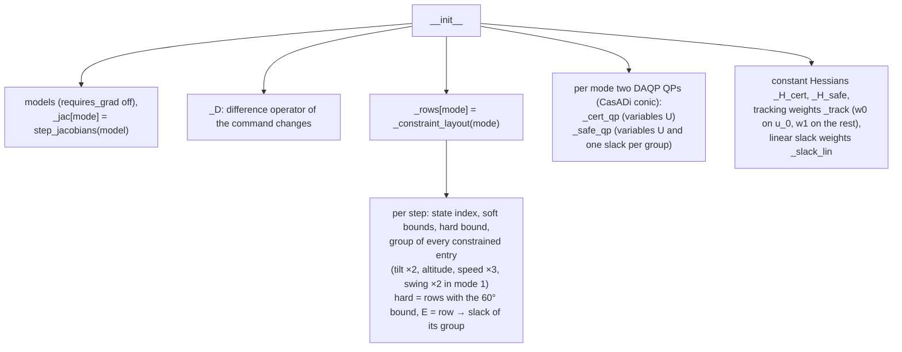
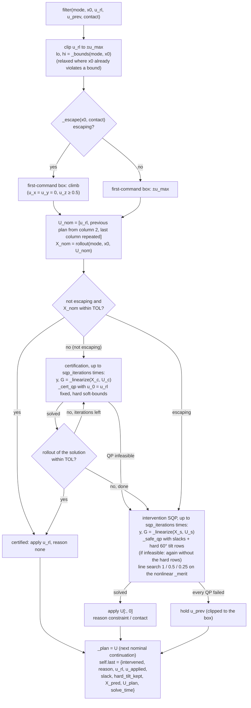
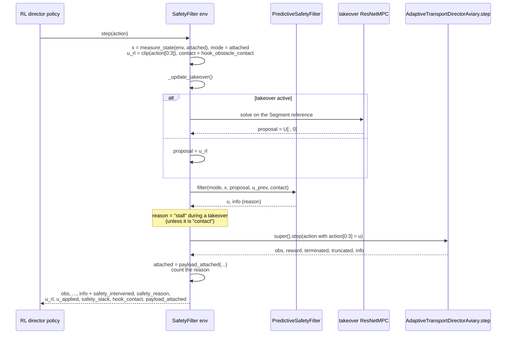

# Predictive safety filter

Thesis: Chapter 5. Two modules:

| Module | Content |
|---|---|
| `envs/predictive_safety_filter.py` | `PredictiveSafetyFilter` (certification + intervention), `SafetyConstraints`, `hook_obstacle_contact`, `tilt_angle` |
| `envs/adaptive_hook_director_safety_filter.py` | `AdaptiveTransportDirectorAviarySafetyFilter`: the director env that runs the filter on every command, plus the stall takeover |

The filter uses the ResNet model and the helpers of `resnet_mpc.py`
(`rollout`, `step_jacobians`, `sensitivity`), but solves its own QPs instead
of calling `ResNetMPC`.

## 1. `PredictiveSafetyFilter`: construction

```python
PredictiveSafetyFilter(models, horizon=36, constraints=None, u_max=1.0, w0=10.0,
                       w1=0.1, w_du=0.5, sqp_iterations=2, dt=1/48, qp_solver="daqp")
```

The environment builds it with `horizon=20` (`FILTER_HORIZON`). The
constructor prepares everything that does not change between steps:



`SafetyConstraints` (dataclass) holds the limits of Table 5.2 and the
contact-escape parameters. `GROUPS`, `SLACK` and `TOL` (class constants)
give the four constraint groups, their slack weights (the priorities) and
the tolerance of the nonlinear check.

## 2. `filter(mode, x0, u_rl, u_prev, contact)`

One call per control step. Returns the applied command and an info dict
(also stored in `self.last`).



The line-by-line description of both QPs is in
[ocp_solvers.md](ocp_solvers.md#5-safety-filter-predictivesafetyfilterfilter-293426-sor).

Helpers:

| Method | What it does |
|---|---|
| `rollout(mode, x0, U)` | nonlinear prediction, X (NX, N+1) |
| `_bounds(mode, x0, hard)` | soft (or hard) bounds per step; a bound that x0 already violates is relaxed to the current value and shrinks by `contraction` per step |
| `_linearize(mode, X, U)` | constrained outputs y and G = dy/dU: the constrained rows of `resnet_mpc.sensitivity` |
| `_violation(mode, X, lo, hi)` | largest violation per group, compared with `TOL` |
| `_merit(mode, U, X, ...)` | the line-search merit of the intervention: the QP cost with the slacks replaced by the violations of the nonlinear prediction, plus a penalty beyond the hard tilt (the counterpart of the MPC's line-search cost) |
| `_escape(x0, contact)` | the contact-escape state machine: starts on contact with tilt > 10°, ends after 0.5 s or when the contact is gone and the tilt is below 8° |

Module functions:

| Function | What it does |
|---|---|
| `hook_obstacle_contact(env, attached)` | the hook touches the connectors or the holder plate, or the cylinder before the payload is lifted (the lever situation of Section 5.1.4) |
| `tilt_angle(x)` | the angle between the body z axis and the vertical from `roll_w`, `pitch_w` |

## 3. The environment: `AdaptiveTransportDirectorAviarySafetyFilter`

A subclass of the director env. The RL director acts on it exactly as on
`AdaptiveTransportDirectorAviary`; the filter is invisible to the policy.

```python
AdaptiveTransportDirectorAviarySafetyFilter(model_file=None, constraints=None,
    filter_horizon=20, stall_distance=0.1, stall_time=1.0,
    waypoint_tolerance=0.25, takeover_time=0.5, takeover_speed=0.4, ...)
```

It owns:

* `safety_filter`: a `PredictiveSafetyFilter` (horizon 20);
* `takeover_mpc`: a `ResNetMPC` (horizon 20, default weights, 5 SQP
  iterations) for the stall takeover;
* the mode tracking (`_attached`, `_rest_z`), the previous applied command
  `_u_prev`, the position history of the stall detection and the
  intervention counters (`reason_count`, `intervention_count`).

### Stall takeover (Section 5.1.4)

`_update_takeover()` keeps the positions of the last `stall_time`. If the
drone moved less than `stall_distance` in that time while it is farther than
`waypoint_tolerance` from the active waypoint, a takeover starts: a
`Segment` from the current position to the waypoint with `takeover_speed`.
During the takeover `_takeover_command(mode, x)` solves the `ResNetMPC` on
that segment, and its command replaces the RL proposal **before** the filter
(so it is filtered too). The takeover ends after `takeover_time` or when the
env advances the waypoint.

## 4. One environment step



The tendon commands of the RL action pass unchanged. The reason strings are
`none`, `constraint`, `stall` and `contact`. `REASONS` still lists `rate` (a
former command-change limit that was removed) so that the reason indices of
`utilities/analyse.py` stay the same.
