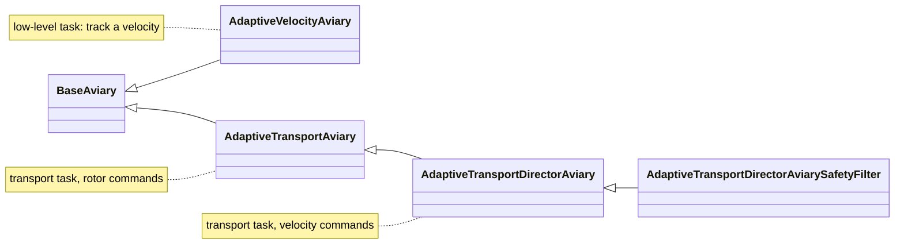
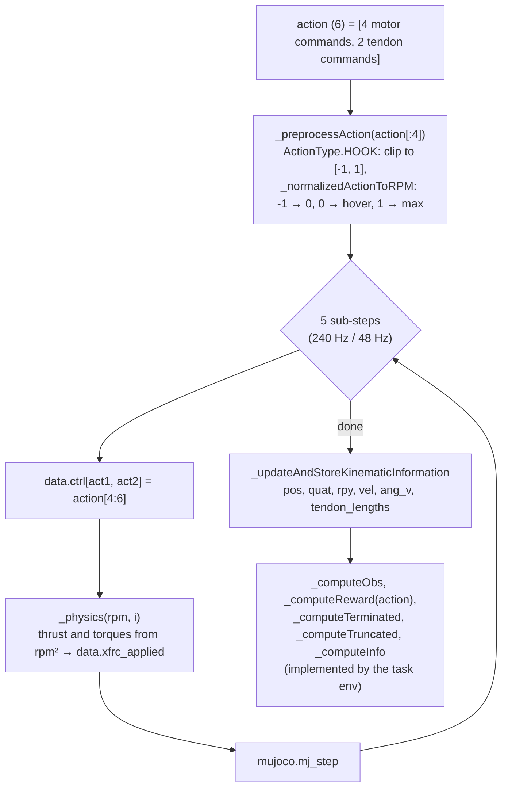
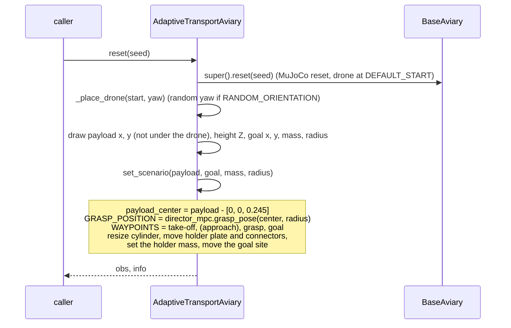
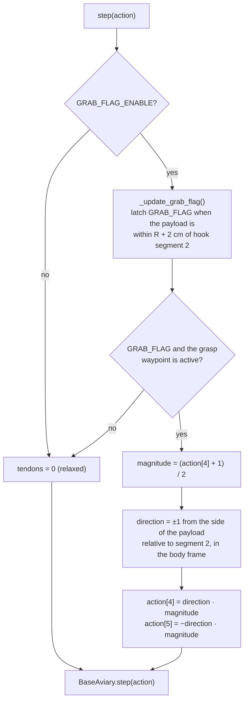
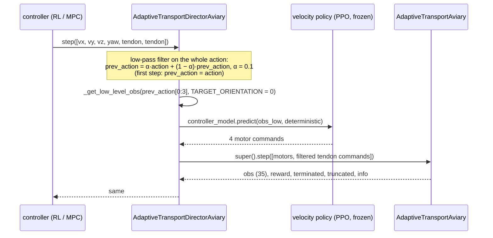

# Simulation and task environments

Thesis: Chapter 2 (system and task), Sections 3.1 and 3.3 (observations,
actions, rewards, episodes). This page describes how they are implemented.

## 1. `BaseAviary` (`envs/base_aviary.py`)

A `gymnasium.Env` that builds a MuJoCo model from a generated XML string,
applies the rotor forces itself and steps MuJoCo. Every task environment of
this work uses it with `drone_model=DroneModel.BB_HOOK`,
`physics=Physics.MJC`, `sim_freq=240`, `ctrl_freq=48` and
`transport_target=True`.

### 1.1 Building the scene: `_generate_aviary_xml`

Called once in the constructor. For `BB_HOOK` it writes:

| Part | XML element | Notes |
|---|---|---|
| drone body `drone0` | free joint `drone0_joint`, Bumblebee meshes (`assets/bumblebee/`) | mass, inertia, thrust and drag coefficients from `DRONE_PARAMS[BB_HOOK]` |
| hook | bodies `segment_1` … `segment_7`, hinge joints `link_1` … `link_7`, geoms `segment_geom_1` … `segment_geom_7` | `link_1` is nearly rigid (±5°), `link_2` … `link_7` curl (±80°) |
| tendons | `tendon1` (+y side), `tendon2` (−y side), routed through the sites `s*_*` | antagonistic: shortening one curls the hook to its side |
| tendon actuators | `act1`, `act2`, control range [−1, 1] | 0 holds the straight rest length, ±1 curls fully |
| sensors | `drone0_tendon1_len`, `drone0_tendon2_len` | the tendon lengths of the observations |
| payload | free body `target`: red cylinder (`target` geom), `left_connector`, `right_connector`, `holder_plate` | resized and moved by the task env at every reset |
| goal | site (green sphere) | moved by the task env |

### 1.2 One `step(action)`

`_getDroneStateVector(i)` returns the 22-element vector
`[pos(3), quat(4), rpy(3), vel(3), ang_v(3), last_rpm(4), tendon_lengths(2)]`
that the task environments slice their observations from.

## 2. Transport task: `AdaptiveTransportAviary` (`envs/adaptive_hook_transport.py`)

The pick-and-place task of Section 2.3. Actions are rotor commands
(`ActionType.HOOK`), so this is the environment of the **flat agent**; the
director env inherits everything from it except the action interface.

### 2.1 Flags (set by the curriculum, see [reinforcement_learning.md](reinforcement_learning.md#2-curriculum))

| Attribute | Meaning |
|---|---|
| `GRAB_FLAG_ENABLE` | the payload has to be picked up (else: waypoints only, tendons always relaxed) |
| `PAYLOAD_TERMINATION` | final task: 4 waypoints (with the approach point) and termination when the payload is lost |
| `RANDOM_ORIENTATION` | random initial yaw |
| `MIN/MAX_PAYLOAD_MASS`, `MIN/MAX_PAYLOAD_RADIUS`, `GOAL_RANDOM_AMPLITUDE` | sampling ranges of the scenario |
| `EPISODE_LEN_SEC` | time limit (10 s in training; the evaluation sets 25 s) |

### 2.2 `reset()` and `set_scenario()`

`set_scenario` can also be called right after `reset()` to replay a given
scenario. `utilities/analyse.py` uses it (`apply_scenario`) to fly the same
scenario with several controllers.

The waypoints come from the same `grasp_pose` function that the MPC uses, so
the grasp target of the RL and of the MPC is the same point.

### 2.3 `step(action)`: the tendon logic

So the policy (or the MPC) only decides **how far** the hook closes; **when**
and **in which direction** it closes is fixed by the environment. `action[5]`
of the agent is never used.

### 2.4 Observation, reward, termination

* `_computeObs` (35 values, world frame): position, roll/pitch/yaw, velocity,
  angular velocity, active waypoint − position, payload − hook segment *j*
  for *j* = 2…7, tendon lengths.
* `_computeReward(action)`: waypoint errors, attitude and angular-velocity
  shaping, the cumulative segment distance (`comulative_segment_distance`),
  bonuses per waypoint, −100 on termination. **It also advances the active
  waypoint** (`_advance_waypoint`) when the waypoint is reached, or, at the
  grasp waypoint, when the payload is grasped. So it has to run exactly once
  per step; the evaluation scripts never call it separately.
* `_computeTerminated`: below the floor, roll or pitch beyond 90°, or (with
  `PAYLOAD_TERMINATION`) the payload more than 1 m from segment 2 while the
  goal waypoint is active.
* `_computeTruncated`: `EPISODE_LEN_SEC` reached.
* `_computeInfo`: `waypoints_reached`, `total_waypoints`, … (read by
  `play.py`).

## 3. Velocity task: `AdaptiveVelocityAviary` (`envs/adaptive_hook_velocity.py`)

The training environment of the low-level policy (Section 3.3.2–3.3.4).

* `reset()` draws a constant target velocity (40 % near hover, 30 % medium,
  30 % full range), the initial yaw (`RANDOM_OREINTATION`, the target yaw is
  always 0), and with `GRAB_FLAG_ENABLE` a payload in about half of the
  episodes (`PAYLOAD_INDICATOR < 0.5`).
* `_hang_payload_in_hook(side)` puts the payload directly into the closed
  hook. The hook joint angles and the payload position are interpolated over
  the radius from recorded simulated grasps, then settled for 0.25 s with the
  drone held in place. So every episode starts from a physically consistent
  hold without having to grasp.
* `step(action)` overwrites the tendon commands: fully closed on the
  payload's side when carrying one, relaxed otherwise. The policy only
  commands the 4 motors.
* Observation (15): roll/pitch/yaw, velocity, angular velocity, target
  velocity, target yaw, tendon lengths. This is the same layout that the
  director env builds in `_get_low_level_obs`.
* The drone starts at 12.8 m height, so the floor is never in the way.

## 4. Director interface: `AdaptiveTransportDirectorAviary` (`envs/adaptive_hook_director_velocity.py`)

The transport task commanded through velocities (Section 3.3.1, Figure 3.3).
The RL director, the MPC director and the safety filter all act on this
environment (or on its safety-filter subclass).

* The velocity policy is loaded in the constructor from `controller_path`
  (`results/final/rl_adaptive_velocity_curriculum/final_model.zip`).
* `prev_action` is the state of the low-pass filter. Its first three entries
  are the **filtered command** that the velocity policy tracks; the MPC
  state and the analysis scripts read it from there
  (`director_mpc.filter_state`). `reset()` clears it.
* The heading entry of the action is not used: the target yaw is always 0.
* Observation and reward are those of the transport task. The RL director
  is therefore trained on the same reward as the flat agent.
* The constructor arguments are fixed (BB_HOOK, 240 / 48 Hz, start at
  [0, 0, 0.5]); only `initial_xyzs` and `render_mode` can be changed.

The safety-filter subclass is described in
[safety_filter.md](safety_filter.md#3-the-environment-adaptivetransportdirectoraviarysafetyfilter).
